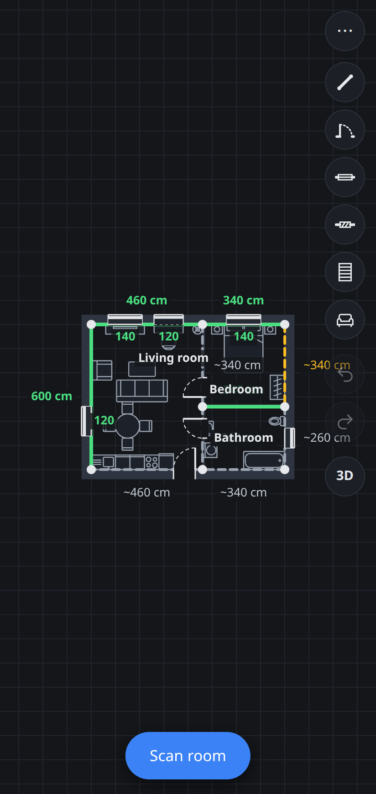
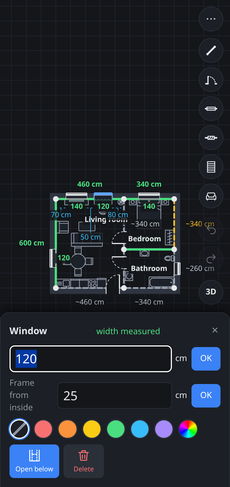
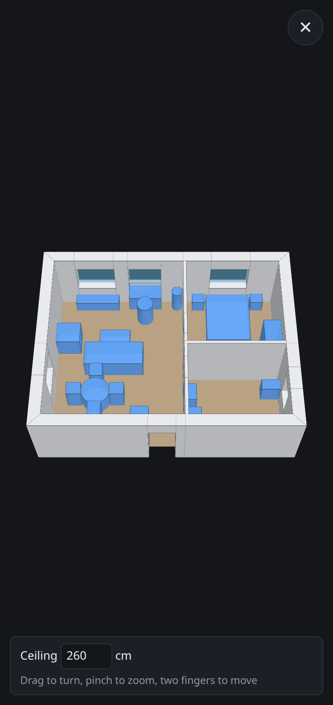
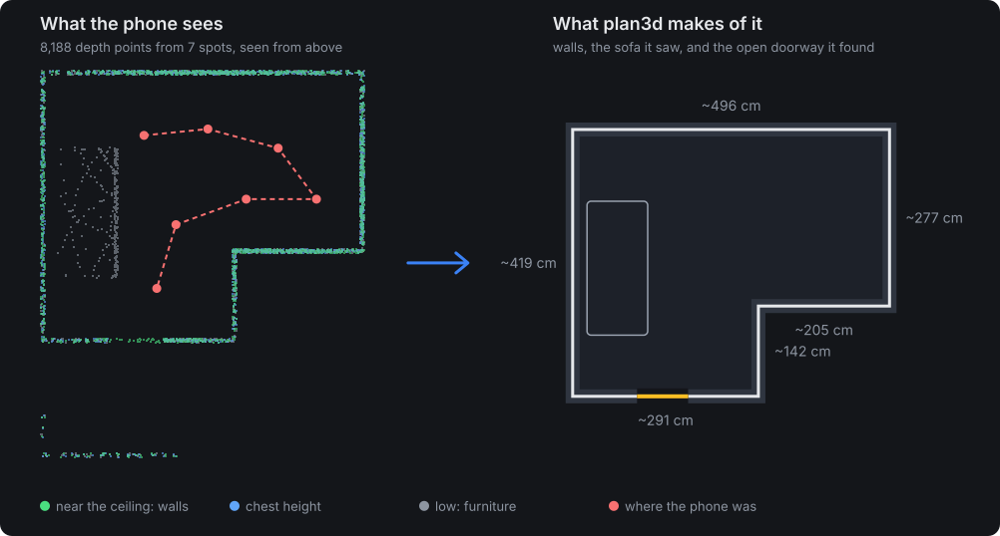
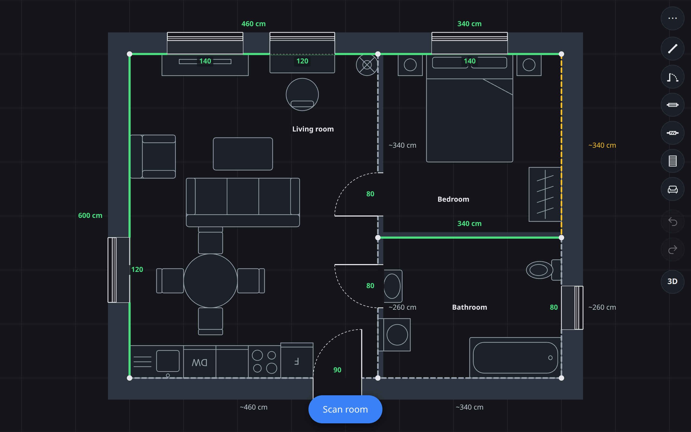
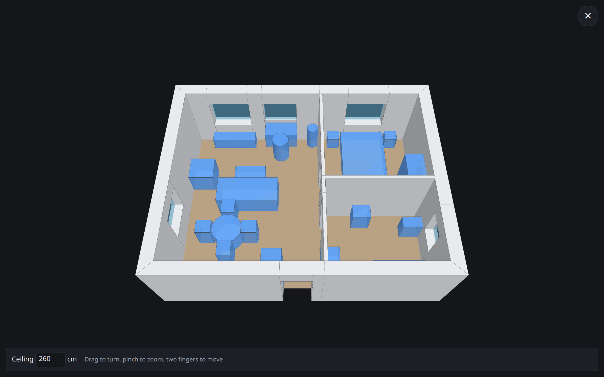

<p align="center"></p>

<h1 align="center">plan3d</h1>

<p align="center"><b>Walk around a room with your phone. Get its floor plan.</b><br>An automatic room scanner that runs in the browser of an ordinary Android phone: no LiDAR, no app store, no account.<br>Then type in the few measurements you trust, furnish it, and see it in 3D.</p>

<p align="center"><a href="https://apiel.github.io/plan3d/"><b>Open the app →</b></a></p>

<p align="center">
  
  
  
</p>

Renovating means measuring the same wall three times because the numbers got lost, and drawing plans that are out of date by the next weekend. plan3d keeps the plan on the phone you already carry.

## The room scanner

Room-scanning apps usually need an iPhone Pro with LiDAR, or a laser and an afternoon of tapping corners. plan3d does it with the depth sensing that ordinary Android phones already have, straight from a web page (WebXR in Chrome; developed on a Pixel 9a). Tap **Scan room**, turn slowly and walk around, tap **Finish**. You don't draw anything: the plan builds itself.

<p align="center"></p>

From a few thousand depth points, the scanner works out:

- **The walls.** It reads them from a band just under the ceiling, above the furniture, so a sofa or wardrobe against a wall doesn't move the wall. Then it squares the corners.
- **The floor and ceiling.** The plan gets your real ceiling height, ready for the 3D view.
- **Open doorways.** It finds them from what the phone saw through them into the next room.
- **Furniture.** It sees what stands in the room, with its size and height (not yet put into the plan; for now you place furniture from the library).
- **Stairs.** Mark a flight while scanning and you get its width, length and number of steps.
- **Your marks.** Optionally, put the centre cross on corners, doors and windows while scanning and tap. Marks are drawn over the camera view, and a mini map shows what has been seen so far.

Phone depth is rough, a few cm off. That's where the second half of plan3d comes in: type the one or two lengths you measured with a tape, and the solver rescales and squares the whole room around them.

*The figure above is a simulated scan of an L-shaped room, run through the real extraction code (`scripts/scan-figure.ts`). After a real scan, ⋯ > **Download last scan data** gives you the raw points, and `npm run replay` draws the same comparison for your own room.*

## What it does

- 📱 **Scan a room with the phone camera.** Walk around and the outline, ceiling height and open doorways come by themselves (see [above](#the-room-scanner)). Mark corners, doors, windows and stairs while you scan if you want.
- 📏 **Make it exact with the measurements you trust.** Type a wall length from your tape or laser and mark the right angles. A least-squares solver fits everything together, and shows which wall is worth measuring next.
- 🏠 **Build the whole flat.** Join rooms through their shared doors and they snap into place across the wall.
- 🪟 **Doors and windows the way they really are.** Door hinge side and swing, window frame depth in the wall, and niches under windows that furniture can slide into.
- 🛋️ **Furnish it.** A library of bathroom, kitchen, bedroom, living and office pieces at their usual sizes. They snap against walls and into corners, and you can resize any of them.
- 🧊 **See it in 3D.** Walls, openings, windows, stairs and furniture, at your real ceiling height.
- 🔒 **Your plans stay yours.** Everything runs in the browser. Plans are kept on the device, export as an SVG drawing with the data inside, and optionally save to your own Google Drive.
- 🤖 **Edit with an AI chat.** The exported SVG carries instructions, so you can hand it to an AI assistant ("move the kitchen wall 30 cm") and import the result back.
- 📲 **Installable.** Add it to the home screen and it works offline like a regular app.

<p align="center">
  
  
</p>

## Get started

1. Open **<https://apiel.github.io/plan3d/>** in Chrome on an Android phone (⋮ > **Install app** puts it on the home screen).
2. Tap **Scan room**, aim at the walls (and now and then the floor and ceiling), turn slowly and walk around the room, then **Finish**. The room appears in the plan.
3. Tap a wall to type its measured length, and tap the corners that are square.
4. Add furniture with the sofa button, then tap **3D**.

At a computer, the same editor works with a mouse and keyboard: draw walls by hand, use the arrow keys to nudge things, Ctrl+Z to undo, and Ctrl+S to save to Google Drive.

The screenshots show a made-up demo flat (`scripts/demo-plan.ts`). `scripts/screenshots.mjs` takes them again, and `scripts/scan-figure.ts` redraws the scan figure.

---

The rest of this page is the full documentation: how each part works, and how to run and develop the app.

## Idea

Renovation planning keeps going wrong because measurements are forgotten or the plan is never updated. The workflow this app is aiming for:

1. **Scan** a room with the phone (Android, WebXR depth): turn on the spot and walk around, the app builds the outline by itself. The result is approximate: walls a few cm off. (Drawing by hand in the editor also works, for use at a computer.)
2. **Tighten** it. Type in the measurements you trust (a wall measured with a tape or laser, a door width) and mark right-angle corners. A least-squares solver finds the corner positions that best satisfy everything: measured values count far more than capture values. The capture is trusted for the room's shape (each wall's direction and relative length), not its size: every room has its own scale, so measuring one wall stretches or shrinks the walls you did not measure in proportion, and further measurements share out the rest. The more you enter, the more accurate the plan.
3. **Join** rooms through shared doors to build the whole flat.
4. **Update** after renovation work by recapturing one room.
5. **Customise** at home: furniture, 2D and 3D views.

## Run

```
npm install
npm run dev        # editor at http://localhost:5173 (Vite picks the next port if taken)
npm test           # solver tests
npm run build      # typecheck + production build into dist/
```

Node 18 is enough (Vite 5, same as plinth3d).

### Pages

- **Scan room (phone)** in the editor starts the AR scan straight away (if the phone or browser lacks something, the editor says what is missing). Turn slowly aiming at walls, floor and ceiling, walk around the room, then Finish: the outline is added to the plan and you are back in the editor. A top-down mini map shows what has been seen so far. Optionally, while scanning, put the centre cross on each corner and tap **Corner**; for stairs tap **Stairs** at the left and the right end of the bottom step's front edge, then at the top edge where the flight arrives (or the other way round, starting at the top: the higher end is the top), and the plan gets the flight with its width, length and number of steps (height climbed / 17.5 cm); for a door or window tap **Door**/**Window** at one side of it (aim at the wall just beside the frame), then aim at the other side, where a dashed line follows the cross with the width under it, and tap the button again, now labelled "2nd side". Marks are drawn over the camera view. The fourth button cancels a half-placed door or window ("Cancel door"), removes the mark under the cross (it turns red, "Remove"), or otherwise undoes the last mark ("Undo").
- `index.html` is the plan editor, phone first: the plan fills the screen, with one **Scan room** button, three tool icons (add a wall, a door, a window) and a ⋯ menu for the rest (the plan's name at the top, tap to rename; square all corners, fit, export/import, last scan data, clear). The name is kept in the plan and names the exported files and the Drive file. Wall tool: tap corners one after the other (tapping an existing corner starts from it or closes the shape; tap the last corner again to stop). Door/window tool: tap a wall, then type the width. Tap a wall or its length to type the measured length or the wall's thickness, see how uncertain its length still is (the orange wall in each room is the one worth measuring next), or tie it to another wall (parallel, same length) (10 cm by default; walls are measured on the face inside the room and grow outwards), tap a door or window to change its width, hinge side or swing, a window's frame position in the wall (cm from the inside face; centred until typed, the frame is 7 cm) and whether the wall under it is filled up to the sill or open down to the floor (**Open below**, a niche: dashed on the plan) (or delete it), tap a corner to hold it at 90° or at a typed angle, or delete it; the stairs tool places a straight flight (size, steps, turn, direction in its panel, drag to move); drag corners (or, with a keyboard, move the selected corner, wall, room, door, window, stairs or furniture with the arrow keys: 1 cm a press, 10 cm with Shift; doors and windows slide along their wall, and the arrows work in a panel until something is typed in its field), pan with one finger, pinch or scroll to zoom. The sofa icon opens the **furniture library** (bathroom: WC, washbasin, shower, bathtub, washing machine…; kitchen, bedroom, living, dining, office), each piece at a usual size: pick one, tap the plan. Near a wall a piece turns its back to it and stands flush (and into the corner when a second wall is near; under a window open below, a piece narrower than the window goes back into the niche, up to the frame); drag to move (it snaps again), tap it to type its width, depth and height, turn it, copy it beside itself (kitchen units in a row) or delete it. ⋯ > **Furniture** shows or hides all furniture on the plan and in 3D. Furniture moves with its room. Boxes the scan detects are still left out of the plan. **Several rooms:** each Scan room adds a room to the right of the others. To put them in their true places, tap a door, choose **Join rooms**, then tap the same door in the other room: that room moves and turns until the two doors face each other across the wall's thickness (joined doors are purple; **Unjoin** detaches). Joined rooms stay attached when a measurement rescales one. Tap the floor of a room to select it and **Delete room**. Undo/redo are the two round buttons under the tools. Distances between a wall's ends and its doors, windows and parts are blue dotted lines inside the room: on every wall with ⋯ > **Door & window distances**, otherwise on the selected wall (or the selected door's or window's) and, with a mouse, on the stretch under it. The **3D** button under them opens the plan in 3D (drag to turn, pinch to zoom, two fingers to move; ✕ goes back): walls at the plan's ceiling height (from the first scan that saw the ceiling, else 2.5 m, editable there), doors cut through up to 2.05 m, windows from 0.9 to 2.1 m with a pane at their frame (a niche leaves the wall under it open from the room to the frame), wall parts in their colour, floors and stairs (17.5 cm per step). Doors are drawn as a leaf with its swing arc, windows as their frame (two lines and the glass) where it sits in the wall, with the sill shaded between it and the room. Plans are kept in `localStorage` and can be exported and imported as JSON.
- `depth.html` is the phone test page for WebXR depth sensing. See below.

### Install on the phone

The deployed site is a PWA: in Chrome on the phone, open it and use ⋮ > **Install app** (or **Add to Home screen**). It then opens full screen from its own icon, and opens without a network too (plans are in the browser's storage anyway; the 3D view works offline once it has been opened online). `public/sw.js` is the service worker: pages come from the network when there is one, so a new deploy shows on the next start; it is only registered in a production build, not in `npm run dev`. The icons are drawn by `node scripts/icons.mjs`. Installing needs HTTPS (GitHub Pages, or `localhost` over `adb reverse` with `npm run build && npm run preview`).

## How the scan works

`src/scan.ts` collects keyframes while you move (every 15 cm or 12° of turning): the camera position and about 700 depth points in world coordinates. `src/scan/extract.ts` then:

1. Finds floor and ceiling from the spread of point heights (ARCore's world is gravity aligned, y up).
2. Takes walls from a band just under the ceiling (1.5 m above the floor up to the ceiling), above most furniture, so a sofa or desk against a wall does not move the wall. Falls back to a wide band if too little was seen up there.
3. Carves free space along every camera-to-point ray, stopping at walls (so a stray reading behind a wall cannot open it); floor and ceiling points are free space themselves. A cell needs 3 rays to count as free.
4. Cleans the free region (closing, hole filling, largest component), traces its outline and simplifies it.
5. Finds the dominant wall direction, rotates the capture to match, and snaps walls to it so rooms come out with clean right angles.
6. Groups the points between the floor and the wall band, inside the room, into furniture boxes (size and height), extended to the wall when they stand against one.
7. Finds doorways nobody marked. Rays through an open door carve the next room too, so the free region is first shrunk by 55 cm, the part where the phone was is kept and grown back: whatever was seen through a neck under ~1.1 m wide is cut off (rooms narrower than that skip this). Then, along each wall, depth points at least 40 cm past the wall, at hip and at chest height, make a doorway. Marked openings win over found ones, and nothing is found next to marked stairs (a stairwell looks like a doorway). A closed door is flush with its wall and cannot be found this way: mark it. Windows are only marked, never found: on the Pixel, depth noise past the walls at chest height came out as windows everywhere. After the scan the editor says how many doors were found this way, and whether a stairs mark could not be used.

Marks change steps 4 and 5. With 3 or more marked corners, the marks define the outline instead of the traced free region: the traced outline only decides their order (so L shapes work), and each wall between two marks is refitted to the wall-band points along its middle 70%, because many depth points place a wall better than one reading at a corner. A fitted corner more than 30 cm from its mark falls back to the mark. So mark every corner, or none. Door and window marks become openings on the nearest wall (within 75 cm). A mark outside the room (a window at the back of a deep recess, or depth that went through the glass) goes to the wall that the line from the phone to it crosses first; each mark keeps where the phone was for that. Openings are stored as an offset from the wall's first corner plus a width, and scale with their wall when the solver rescales the room; a width typed in the editor stays fixed.

The extraction is covered by tests on synthetic rooms (rectangle, rotated rectangle, L shape, noisy readings with stray points, a furnished room). On a real phone (first try, furnished room, before the upper-band change) the result was "not bad but messy".

### Debugging a real scan

After a scan, the editor offers **Download last scan data** (raw keyframes and marks as JSON; kept in memory until the page is reloaded). On the computer:

```
npm run replay -- scan-....json
```

prints floor/ceiling, wall lengths, doors/windows and furniture, and writes `scan-....svg`: raw top-down points on the left (green: wall band, grey: lower, red: camera positions, pink squares: marked corners, blue/cyan lines: marked doors/windows), the extracted room and furniture on the right. Use it to tune the constants at the top of `src/scan/extract.ts`, and add good files as test fixtures.

## Google Drive sync (optional)

The ⋯ menu gets **Save to Google Drive** / **Load from Google Drive** once `CLIENT_ID` in `src/drive.ts` is set. The page signs in with Google Identity Services and calls the Drive REST API directly (no backend). It uses the `drive.file` scope: the app only sees the files it created itself and the ones picked in the Picker. Each plan is saved as `<plan name>.svg` (the plan drawing with its JSON inside, see `src/planfile.ts`); saving an unnamed plan asks for a name first. Saving goes back into the file the plan was loaded from or last saved to (renamed if the plan was renamed; remembered in `localStorage`), else into a file with the plan's name, else a new one. With a keyboard, **Ctrl+S** saves back into that file (once the plan was loaded from or saved to Drive). Clearing the plan or importing a plan with another name forgets that file. An older `plan3d.json` is still loaded. Plans stay in the user's own Drive. Everyone using the deployed site uses the same client ID but their own account.

One-time setup:

1. <https://console.cloud.google.com/>: create a project (e.g. "plan3d").
2. APIs & Services > Library: enable **Google Drive API**.
3. APIs & Services > OAuth consent screen (Google Auth Platform): app name, your email, user type External. Add the scope `.../auth/drive.file`. Leave it in **Testing** and add your Google account under **Test users** (only listed accounts can sign in; publish it later to open it to anyone).
4. Credentials > Create credentials > OAuth client ID > **Web application**. Authorized JavaScript origins: `http://localhost:5173` and your GitHub Pages origin (`https://<user>.github.io`, no path).
5. Paste the client ID into `CLIENT_ID` in `src/drive.ts`. It is public, safe to commit.

Optional, to **choose any SVG/JSON file** when loading (Google Picker; the app then gets access to just that file): enable **Google Picker API** in the same project, Credentials > Create credentials > **API key**, restrict it to HTTP referrers (your two origins) and to the Picker API, and paste it into `API_KEY` in `src/drive.ts`. Without it, Load opens the newest SVG the app saved.

## Depth test on a phone

`depth.html` checks whether the phone gives usable depth through WebXR and measures between two points, to compare with a tape. Aim the crosshair at a point and tap, then aim at a second point and tap.

WebXR needs a secure context (Chrome on Android):

- **Over USB:** `npm run dev`, `adb reverse tcp:5173 tcp:5173` (use the port Vite printed), open `http://localhost:5173/depth.html` on the phone.
- **Same WiFi, no cable:** open `http://<computer-ip>:5173/depth.html` on the phone, after enabling `chrome://flags/#unsafely-treat-insecure-origin-as-secure` for that exact address and relaunching Chrome. `ufw` on the computer may need the port opened for the LAN.
- **GitHub Pages:** HTTPS, works without flags once deployed.

Result on a Pixel 9a: depth works, measurements are "not perfect, but not bad". Not yet compared systematically against a tape, nor on blank white walls.

## Code

| File | What |
| --- | --- |
| `src/model.ts` | Plan data model (points, walls, constraints) and edit helpers. Metres, y down. |
| `src/solver.ts` | Least-squares adjustment (Levenberg-Marquardt, numeric Jacobian): capture shape per room at a free scale, measured distances, right and typed angles, parallel and equal-length walls; each wall's remaining uncertainty from the covariance. `SIGMA` sets how much each kind of fact is trusted. |
| `src/solver.test.ts` | Solver tests (vitest). |
| `src/drive.ts` | Save/load the plan in Google Drive as `plan3d.svg` (picture with the JSON inside) (token via Google Identity Services, Drive REST). |
| `src/rooms.ts` | Rooms (the areas closed in by walls) and groups (corners joined by walls), joining walls at T junctions, room names, joining rooms through a shared door, duplicating and deleting a room. |
| `src/history.ts` | Undo/redo over plan snapshots. |
| `src/stairs.ts` | Straight stairs: geometry for drawing and tapping. |
| `src/furniture.ts` | Furniture library (sizes and plan symbols as shapes in the piece's own frame), geometry, snapping against walls, icons and SVG. |
| `src/main.ts` | Canvas editor and side panel. |
| `src/view3d/build.ts` | The plan as solids for 3D (outlines pulled up between two heights): walls mitred round each group and cut around openings, panes, floors, stairs, furniture. No three.js, tested in `build.test.ts`. |
| `src/view3d/view.ts` | The 3D view with three.js and OrbitControls, loaded only when opened. |
| `src/scan.ts` | AR scan, started from the editor: collects depth keyframes, crosshair marks drawn over the camera, mini map, adds the room to the plan. |
| `src/scan/extract.ts` | Keyframes to room outline (see above). |
| `src/scan/extract.test.ts` | Extraction tests on synthetic rooms. |
| `src/scan/simulate.ts` | A simulated scan: the depth points a phone would see in a known room (tests and the README figure). |
| `scripts/replay.ts` | Replays a downloaded scan through the extraction and writes an SVG. |
| `scripts/demo-plan.ts`, `scripts/screenshots.mjs`, `scripts/scan-figure.ts` | The made-up demo flat and the README screenshots taken from it with headless Chrome (`docs/screenshots/`); the scan figure (`docs/scan.svg`). |
| `src/storage.ts` | Plan persistence in `localStorage`. |
| `src/planfile.ts` | The plan as an SVG file: a drawing carrying the plan JSON in `<metadata>` and instructions for an AI editing it; reading .svg or .json back with checks. |
| `src/xr.ts` | WebXR matrix helpers shared by the scan code. |
| `public/sw.js`, `public/manifest.webmanifest` | Installable app (PWA): service worker for offline use, app name and icons (`scripts/icons.mjs` draws them). |
| `src/depth-test.js` | WebXR depth test page logic (plain JS, predates the scan). |

See [TODO.md](TODO.md) for what is next.
